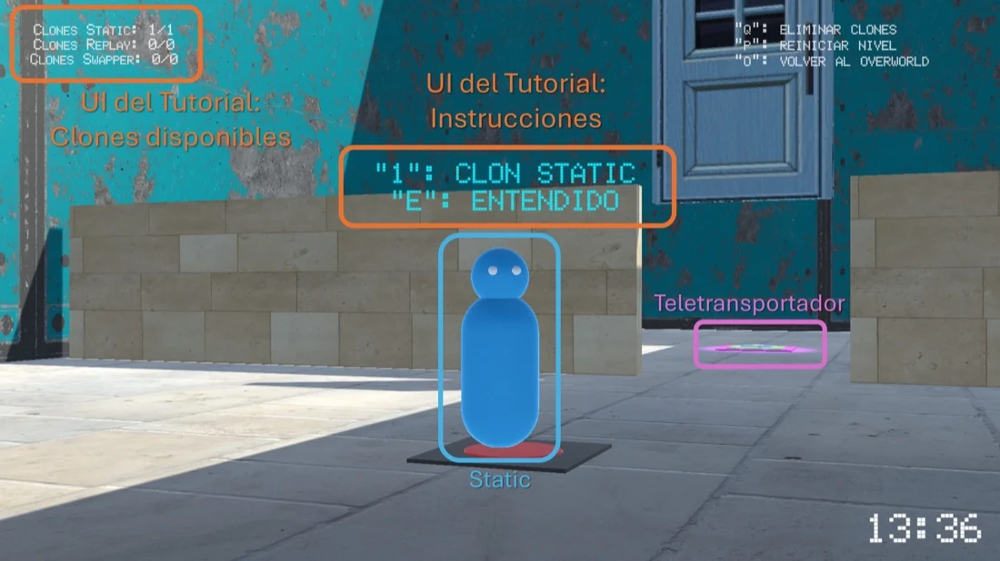
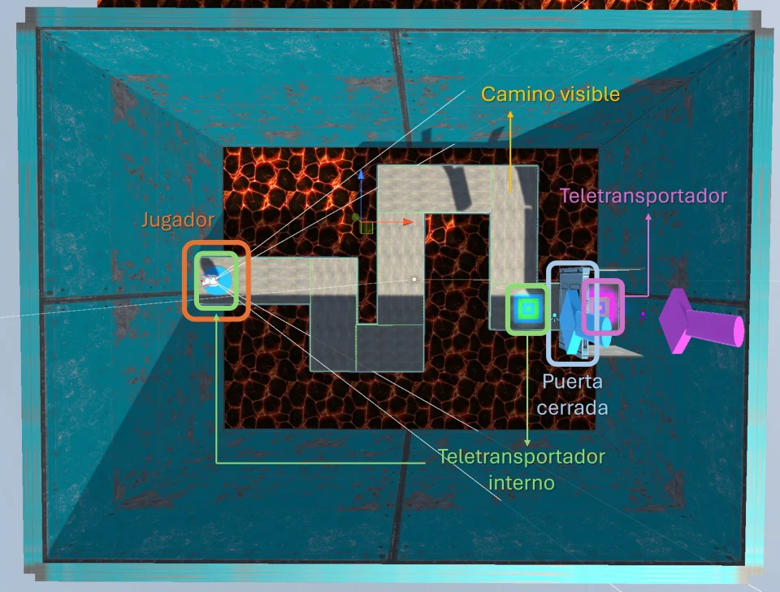
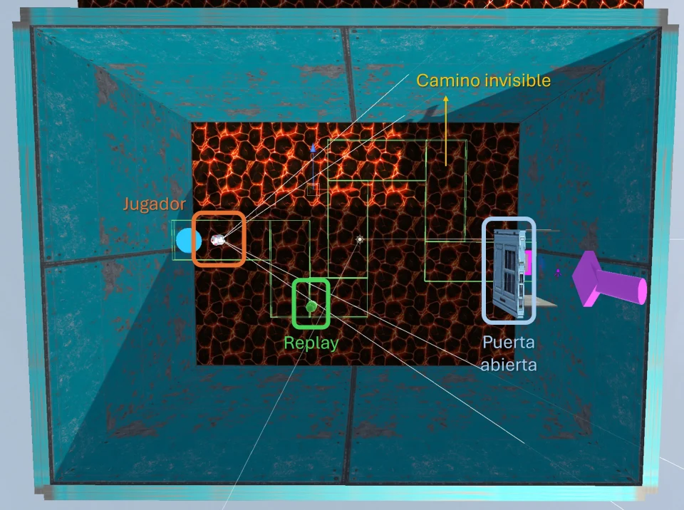
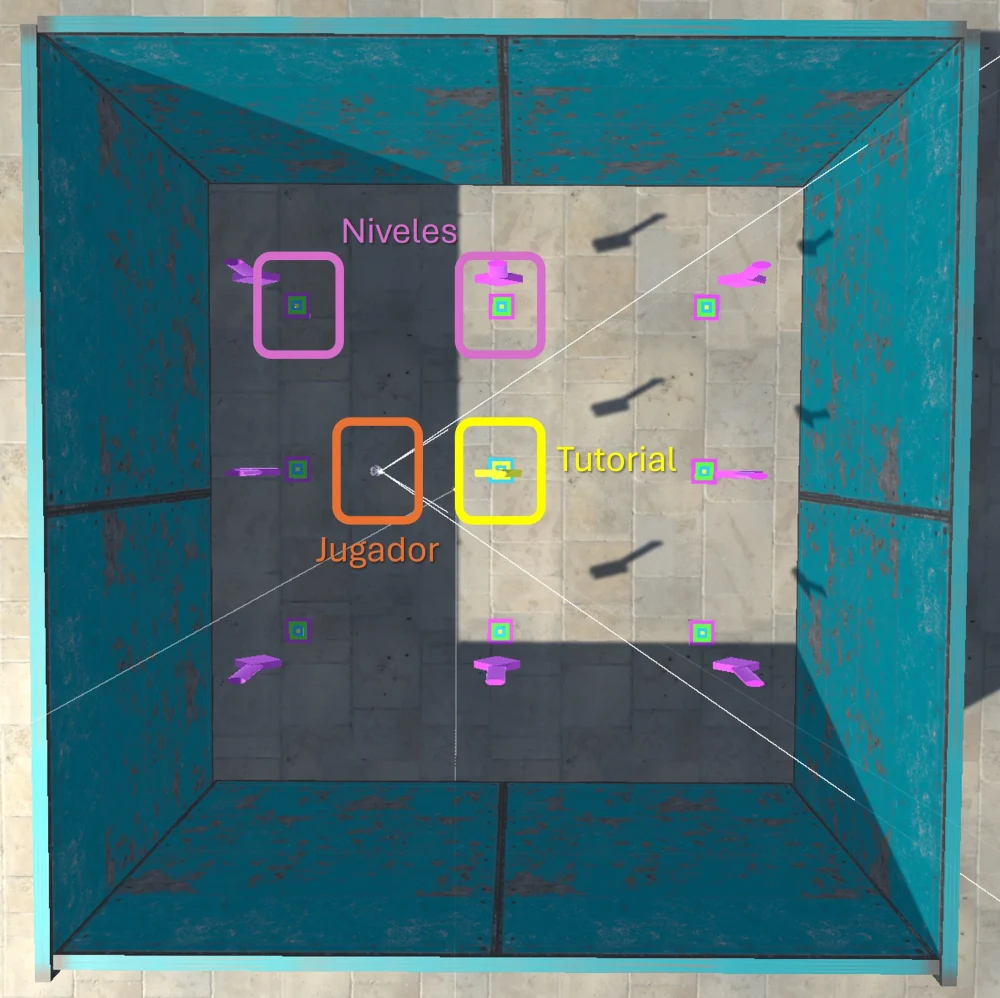
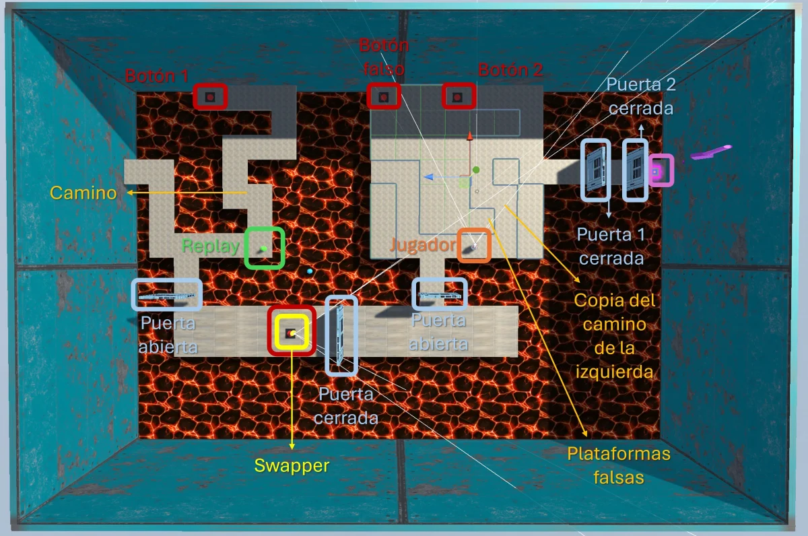

# Chrono Clones

A first-person 3D puzzle game demo built in Unity and C# for my 2024 Bachelor's Final Project in Computer Engineering at Universidad Carlos III de Madrid.

[Read the thesis (Spanish PDF)](docs/chrono-clones-tfg.pdf) · [Windows demo releases](https://github.com/juanmavillard/chrono-clones/releases)

You play a scientist experimenting with three types of clones in a laboratory. The goal is to complete eight puzzle rooms within a shared 15-minute time budget. You choose the order of the rooms from a central hub, the **Overworld**, and use the clones to reach each room's exit teleporter.

## How the game works

The Overworld connects the eight challenges and the tutorial. The tutorial presents the same pressure-plate-and-door puzzle three times, with a different clone available each time. It teaches both the controls and the idea that different tools can solve the same problem.

| Clone | Behaviour |
| --- | --- |
| **Static** | Appears at the player's position and stays there unless pushed. Its physical presence can hold down a pressure plate or help create a path. |
| **Replay** | Repeats a movement sequence recorded by the player. Press **R** to start recording, then press it again to stop early or wait for the 15-second limit. Press **2** to create the clone at the recording's starting position and replay the sequence. It disappears after playback. |
| **Swapper** | Appears at the player's position and can be pushed like a Static clone. Press **F** to transfer control to it. While you control the clone, the original character copies its movements relative to its own coordinate axes. You can switch control back to the original character. |

Each room limits how many clones of each type you can create, shown in the interface. Most rooms allow at most one per type; creating another replaces the previous one. Level 3 makes an exception, allowing up to 15 Static and 15 Swapper clones to build a bridge over lava. Press **Q** to clear your clones and try another approach.

The levels were designed around particular clones or combinations, while allowing alternative solutions. You can experiment with the available tools and leave a difficult room to try another one.

### Time and progression

- The shared timer runs inside the puzzle rooms and pauses in the Overworld.
- Completing a room through its exit teleporter records its completion and the time spent.
- Press **P** to restart a room or **O** to leave it unfinished. The time spent on that attempt is returned to the shared budget.
- Completing all eight rooms within the time budget wins the game. Running out of time ends the run.

## One puzzle, two possible solutions

In **level 1**, platforms form a visible route over lava. An internal teleporter sends you back to the start, makes the platforms invisible and opens the door to the exit teleporter.

One solution is to record yourself crossing the visible path, then create a Replay clone after returning to the start. Following the clone helps you cross the now-invisible path.

| Record the visible route | Follow the Replay clone after the path disappears |
| --- | --- |
|  |  |

Another solution is to place a Swapper clone near the closed exit before activating the internal teleporter. Once you are back at the start and the door has opened, switch control to the clone to reach the exit. This flexibility was a deliberate part of the level design (thesis section 4.4.1).

## The hub and a combined challenge

| Overworld | Level 7 |
| --- | --- |
|  |  |

The Overworld gives access to the rooms in any order. Level 7 combines all three clones: Static holds a pressure plate, Swapper changes which side of a door you can control, and Replay helps trace the safe route across a matching layout of real and false platforms. The complete sequence is documented in thesis section 4.5.2.

## My contribution and technical work

I researched temporal mechanics in other games, designed the clone behaviours and puzzle rooms, implemented the gameplay in C#, and carried out internal testing and an external playtest. The visual assets are credited in [asset credits](docs/credits.md).

The implementation includes Rigidbody-based movement and interactions, recording and replaying applied movement forces, camera and control switching, scene transitions, and a persistent time manager that tracks time and completion across rooms. During development, I changed Replay from continuous recording to player-controlled recording and replaced linear progression with the Overworld. Chapters 3–5 of the thesis describe those decisions and iterations; Appendix A contains the original C# listings.

## Player evaluation

Fifteen friends and fellow students tested the demo. The questionnaire combined adapted UPEQ items with questions about the clones, puzzles, controls and interface, plus open comments.

| Result | Participants |
| --- | ---: |
| Rated the need to use clones creatively and strategically at 4 or 5 out of 5 | 13 / 15 |
| Chose Swapper as the most fun clone | 8 / 15 |
| Chose Replay as the least useful clone | 10 / 15 |
| Reported a technical problem | 7 / 15 |

The small convenience sample helped identify improvements to replay accuracy, collisions, clone placement and the clarity of the tutorial and objectives. These are findings and proposed improvements from the evaluation. Chapter 6 contains the full results and figures.

## Running the Windows demo

Download the Windows x64 ZIP from [Releases](https://github.com/juanmavillard/chrono-clones/releases), extract the entire archive and run `v1.0.exe`. Keep the accompanying folders and DLLs alongside the executable. The build uses Unity 2022.3.37f1 and the game and tutorial are in Spanish.

| Keys | Action |
| --- | --- |
| WASD, mouse, Space | Move, look and jump |
| 1 / 2 / 3 | Create a Static / Replay / Swapper clone |
| R | Start recording; press again to stop before the 15-second limit |
| F | Switch control between the original character and Swapper clones |
| Q | Clear clones |
| P / O | Restart the room / leave it for the Overworld |
| E | Dismiss tutorial instructions |

## Full thesis

The [original thesis (Spanish PDF)](docs/chrono-clones-tfg.pdf) documents the complete project.

| Topic | Where to find it |
| --- | --- |
| Mechanics and implementation | Chapter 3 |
| Puzzle and level design | Chapter 4 |
| Internal testing and iterations | Chapter 5 |
| Player evaluation and results | Chapter 6 |
| Original C# listings | Appendix A |

**Academic title** · *Diseño e implementación de mecánicas de videojuegos basadas en la dimensión temporal*

**Author** · Juan María Villard Bardón

**Supervisor** · Álvaro Montero Montes
